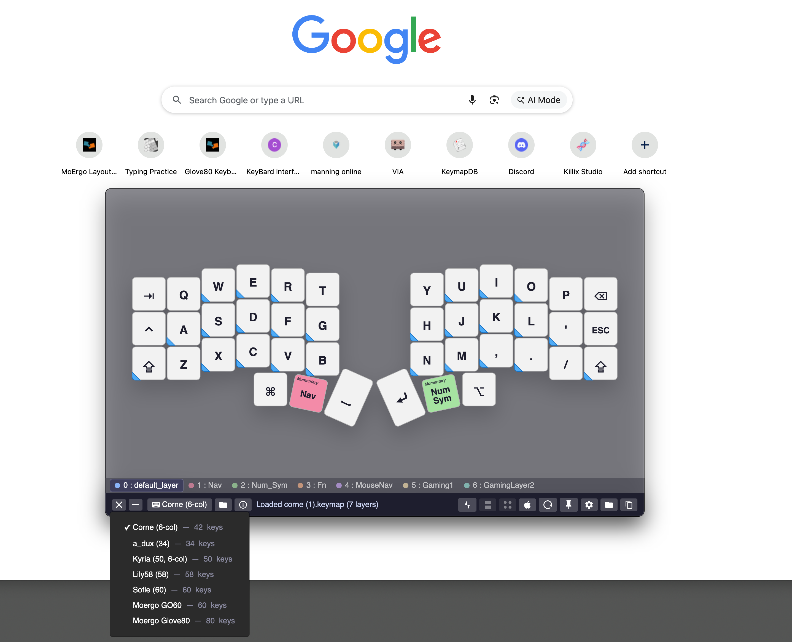
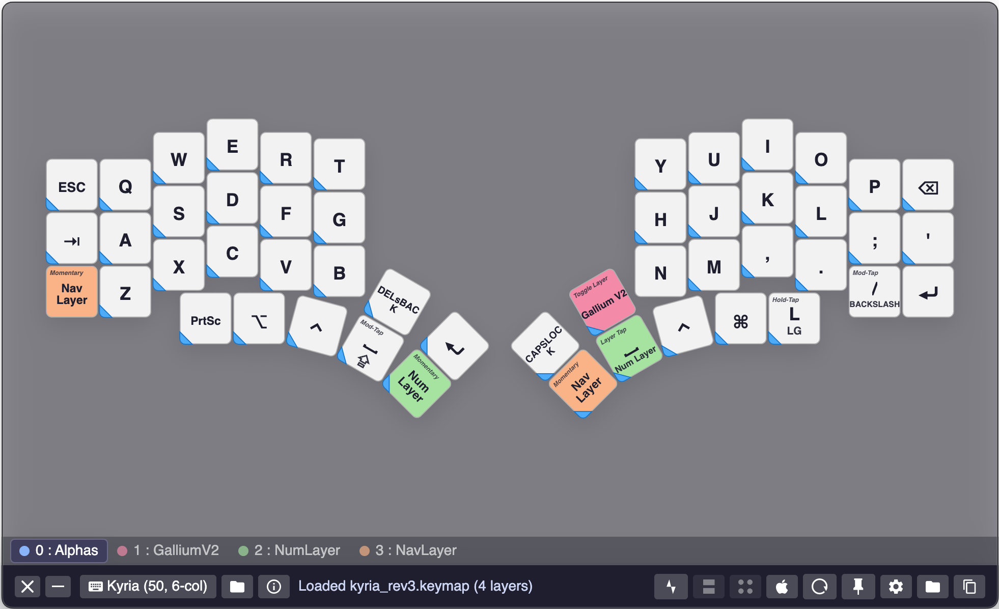
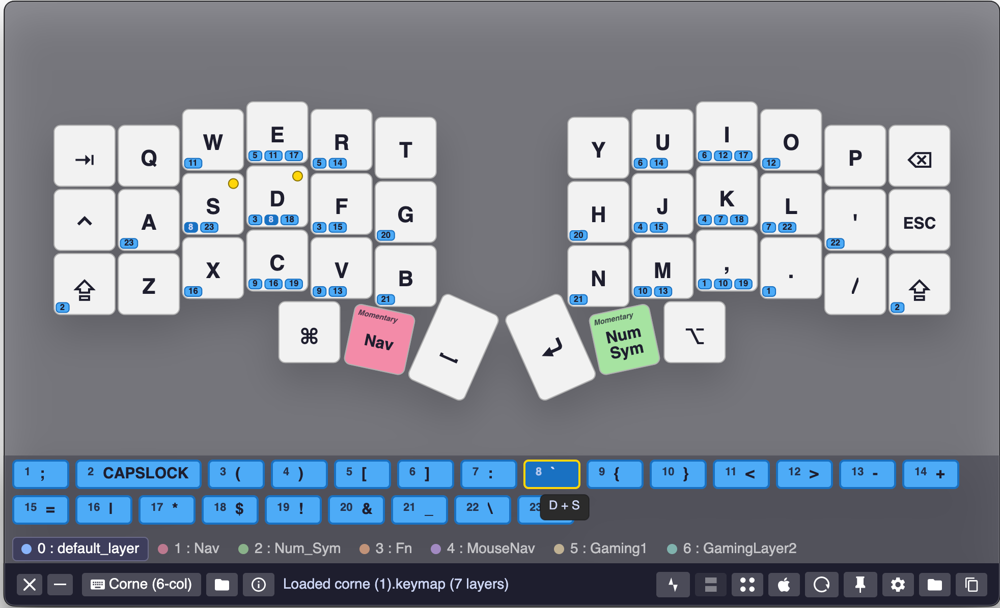
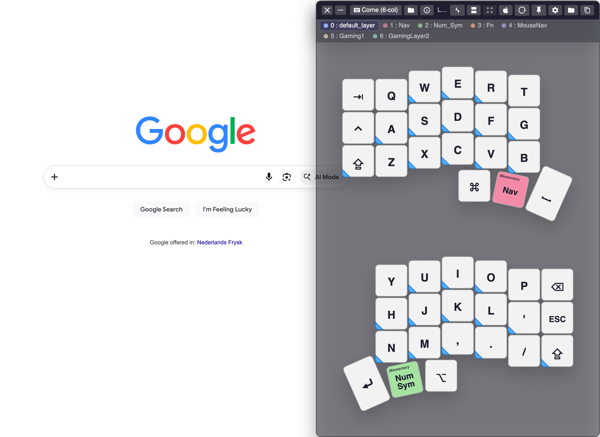
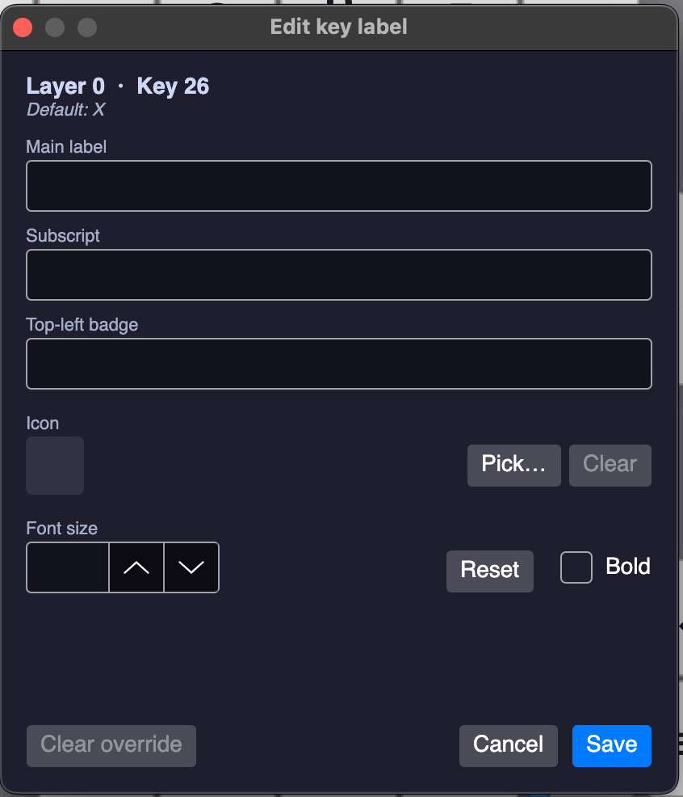
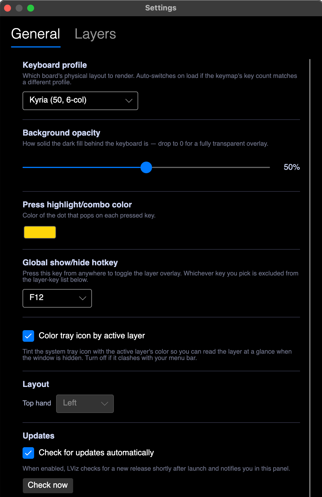
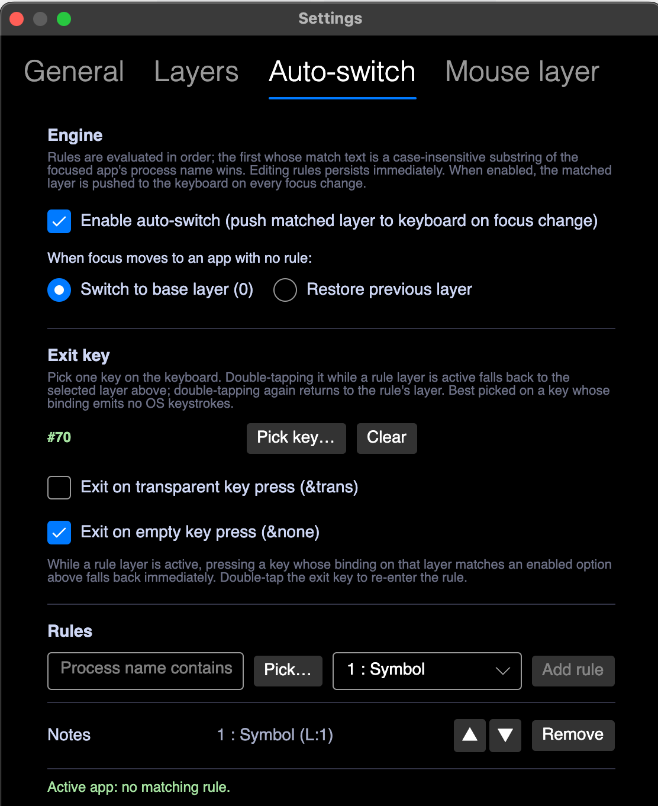

#  LViz — ZMK keymap editor and layer visualizer

A cross-platform desktop app (Windows, macOS, Linux) for your ZMK
keyboard. It edits your `.keymap` file, saving locally or as a commit
to your zmk-config on GitHub, and, as a floating overlay, shows the
active layer in real time over Raw HID.



> 📖 **Documentation** — how everything works (the overlay, device routing,
> action pipelines, the `lviz` CLI, and the wire protocol, with flow diagrams)
> lives in the **[project wiki](https://github.com/ovandongen/LViz/wiki)**. This
> README stays focused on install and build.

## What it does

Since v3, LViz is a **keymap editor** as well as a viewer. Open your
`.keymap` from disk or straight from your zmk-config repository on
GitHub, change keys, layers and combos on a picture of your board, review
the changes, and save. LViz writes a real `.keymap` file: it changes only
the bindings, layers and combos you edited and leaves the rest of the file
as it was, including comments, formatting and your `#define` names.

Since v3.1, LViz also sets up the firmware side: a wizard adds the Raw HID
modules to your zmk-config, and LViz flashes the firmware GitHub builds from
it onto your board, half by half.

It is still the overlay it was in v2: it labels the keys from your
keymap, follows the active layer over Raw HID, draws combos on top, and
lets you override any key label by hand. On the two Moergo boards (Glove80 /
GO60) it also loads the Layout Editor's `.json` export, for viewing. It
pushes layer state **back** to the firmware too: per-app auto-switch rules
and a mouse-idle layer push.

Forked from
[moergo-layer-viz](https://github.com/ovandongen/moergo-layer-viz) and
generalized so the engine can host arbitrary ZMK boards.

### Beyond the overlay

Over the same Raw HID transport, LViz also runs a cross-device **capability
bus**: it discovers what each connected HID device can do, **routes** actions
between devices (Device Routing), runs **action pipelines** triggered by keyboard
signals / host events / app focus, and exposes a small **`lviz` CLI** to drive it
all from scripts. See the
[wiki](https://github.com/ovandongen/LViz/wiki) for the full guide.

## Status

LViz 3 is in daily use on macOS, Windows and Linux. Keep your keymap under
version control (or rely on the local backups) and report anything odd on
the [issue tracker](https://github.com/ovandongen/LViz/issues).

**Firmware.** The editor works on the `.keymap` file alone and needs no
firmware changes. The live features (active layer, key-press highlighting,
auto-switch and the mouse-idle layer push) need the Raw HID firmware modules
described under [Firmware](#firmware). **Set up live features…** in the
Load keymap menu adds them to your zmk-config for you, and **Flash
keyboard…** installs the result. Both are new in v3.1 and have been tried on
only a few boards so far, so please report how they work on yours.

**Not editable yet:**

- Hold-tap and home-row-mod settings (tapping term, flavor, …). You can put
  the keymap's own hold-taps on keys, but not change their definitions.
- Macros: the same. You can use them on keys, but not edit them.
- Conditional layers. A layer that a conditional layer, a combo or a
  `#define` outside the layers refers to can't be deleted. If you just
  changed the combo so it no longer uses the layer, save first, then delete.
- Multi-select, drag-to-swap, copy/paste of keys, and reordering layers by
  dragging their tabs (use Move left/right instead).
- MoErgo Layout Editor `.json` keymaps (view only; edit the `.keymap`).
- Board layouts are saved in LViz's app data. A copy you also saved into your
  zmk-config folder isn't updated by later edits, and layouts are never
  committed to GitHub (only keymaps are).

**Other limits:**

- The `.keymap` reader is lean: `#include` lines are skipped, function-like
  `#define` macros aren't expanded, and recursive custom-behavior resolution
  and `/delete-node/` aren't supported. Saving refuses a layer that calls a
  function-like macro and names its line, rather than guessing.
- Live-features setup refuses dongle configs (a dongle as the central) for
  now.
- Flashing copies `.uf2` files onto the UF2 bootloader drive (nice!nano,
  MoErgo and similar). Boards that flash another way (DFU, serial) aren't
  supported. Starting the bootloader from LViz needs the central on USB; over
  Bluetooth only, you put the half into its bootloader by hand.
- Linux: no global show/hide hotkey (it needs per-WM cooperation that isn't
  shipped). LViz finds a bootloader drive under `/media`, `/run/media` or
  `/mnt`; if your desktop doesn't mount it by itself, mount it in your file
  manager. A locked Secret Service keyring isn't unlocked for you, so the
  GitHub sign-in then lasts only until LViz quits.

## Supported boards

Bundled physical layouts:

| Board | Keys |
| --- | ---: |
| Corne (6-col) | 42 |
| a_dux | 34 |
| Kyria (6-col) | 50 |
| Lily58 | 58 |
| Sofle | 60 |
| Moergo GO60 | 60 |
| Moergo Glove80 | 80 |

**Any other board:** pick **My own board…** in the board picker. The layout
wizard reads your zmk-config folder, or a single `.dtsi`, `.overlay` or
`info.json` file, and builds a layout from a ZMK physical layout, a QMK /
keymap-editor `info.json`, or (roughly) a matrix transform. With no usable
files at all, describe the board (split, keys, columns, thumbs) and place the
keys in the editor.

Adding a bundled board means dropping its physical-layout `dtsi` into
[src/LViz.Core/Resources/](src/LViz.Core/Resources/), declaring it as
an `EmbeddedResource` in the csproj, and subclassing
[DtsiKeyboardProfile](src/LViz.Core/Layout/DtsiKeyboardProfile.cs).
[CorneProfile.cs](src/LViz.Core/Layout/CorneProfile.cs) is the
template to copy.

## Features

### Keymap editor

- **Edit mode.** Press the edit button to start. A banner shows the number of
  changes, keys you changed are marked on the board, and undo/redo cover
  every step. Nothing is written until you press **Save**, and you get a
  **review dialog** first that lists every key, layer and combo change.
  Quitting with unsaved changes asks first.
- **Ring key editor** (the default). Double-click a key, or select it and
  press Enter, and a ring of choices opens around it: key, hold-tap, layer,
  Bluetooth, output, lighting, mouse, system, clear, and the keymap's own
  behaviors. Each choice explains what it does as you point at it. The
  ring's bottom-right button opens the classic **key dialog** for the same
  key. **Settings → General → Ring key editor** switches the default to the
  dialog.
- **Behaviors with pickers:**
  - keycodes, searchable and grouped, with "Used in this keymap" first,
    modifier wraps (`LS(…)`, `LC(…)`, …), and a recorder that takes the key
    you press on your computer keyboard;
  - layers, for `&mo`, `&lt`, `&to`, `&tog`, `&sl`;
  - named commands for `&bt` (including the profile number), `&out`,
    `&rgb_ug`, `&mkp`, `&msc` and `&mmv`, plus `&bootloader`, `&sys_reset`
    and `&caps_word`;
  - the keymap's own hold-taps and macros. A hold-tap that always targets
    the same layer, such as MoErgo's `&magic`, comes with that layer filled
    in, so it's a one-click pick;
  - **Custom binding** for anything else: type the binding, and LViz checks
    it before it's accepted.
- **Quick clears.** Select a key and press Delete to make it `&trans`, or
  Shift+Delete to make it `&none`.
- **Layers.** Add, duplicate, rename, move and delete layers from the
  layer menu or with shortcuts. Every layer reference in the file is
  renumbered in the file's own style: where the file names its layers with
  `#define`s, those defines are kept and their values updated. Keys that
  pointed at a deleted layer are cleared (undo brings them back). LViz's own
  per-layer settings (colours, hidden tabs, key label overrides, auto-switch
  rules) move with their layer when you save.
- **Combos.** Add, edit and delete combos: pick the keys on a picture of the
  board, then set the name, binding, timeout, layers, slow release and
  require-prior-idle. The dialog warns about the usual pitfalls (the same
  keys as another combo, more than four keys, a key in too many combos) and
  won't save a combo with fewer than two keys or a clashing name.
- **Saving:**
  - local files: a backup of the previous version is kept in LViz's app data
    (the newest 20 per keymap), and a file changed on disk since you started
    editing asks before it is overwritten;
  - GitHub: a commit straight to the branch, with a commit message generated
    from your changes (editable in the review dialog). If the file changed on
    GitHub in the meantime, LViz asks whether to reload or overwrite.

### GitHub zmk-config

- Sign in with GitHub (device code, via the "LViz for ZMK" GitHub App; LViz
  only sees the repositories you install it on). The login is kept in the OS
  keychain.
- Flashing a GitHub build uses a second App, **"LViz for ZMK Builds"**, with
  only **Actions: read**: it can see your workflow runs and download their
  firmware, nothing else. You sign in to it, and install it on the repo, only
  when you first flash from LViz; the main App never gets Actions access.
  Its login is kept in the keychain apart from the main one. Signing out of it
  (in the flash window) also deletes the downloaded firmware.
- **Open from GitHub…** in the Load keymap menu: pick a repository and branch, and
  LViz lists the keymaps it finds with the board each one fits.
- Repos are cached locally, so keymaps open offline. At startup, on a board
  switch and on Reload, LViz checks GitHub in the background and loads a
  newer commit when there is one.

### Live features and flashing

- **Set up live features…** (Load keymap menu, or the status-bar hint that
  shows when the loaded keymap's zmk-config has no modules yet). The wizard
  reads your config, local or on GitHub, and adds what live features need:
  the two modules in `west.yml`, the `raw_hid_adapter` shield on the central
  half in `build.yaml`, and the settings in your `.conf`. You pick the
  features (RGB control, signal keys, emit keys, **Flash from LViz**), review
  every change as a diff, and save: as one commit on GitHub, or to the local
  files with a backup. Comments and layout in those files stay as they were.
  A config that already has the modules opens with the missing features to
  add.
- **Flash keyboard…** (Load keymap menu) installs the firmware:
  - from GitHub: the newest successful GitHub Actions build of the branch.
    This needs a second, read-only sign-in (see
    [GitHub zmk-config](#github-zmk-config));
  - or a `.uf2` file you pick, for a local config or any other build.
    LViz warns when a file for the central half lacks flashing support.
- **Halves.** LViz knows from your config which half is the central. The
  central is always ticked; the other half only when the config changed
  more than the keymap since you last flashed it from LViz.
- **Per half:** with **Flash from LViz** in the firmware, **Start** puts the
  half into its bootloader. Otherwise you press its bootloader key or
  double-tap reset. LViz waits for the bootloader drive, copies the file,
  and checks that the board comes back with the new firmware. It won't copy
  onto a drive that names the other half (MoErgo boards).
- **Build status.** After you save to a GitHub zmk-config, the status bar
  follows the firmware build: *Building firmware…*, then *Firmware ready:
  Flash* or *Firmware build failed* (a click opens the run on GitHub).

### Layouts

- **User layouts** for boards LViz doesn't bundle, made by the layout
  wizard (see [Supported boards](#supported-boards)) and stored as
  `.layout.json` in LViz's app data, with a ZMK physical-layout `.dtsi`
  next to it (unless the layout came from one). The wizard can save a copy
  into your zmk-config's `config` folder too, so a second computer picks
  the layout up without the wizard.
- **Layout importers:** ZMK `zmk,physical-layout` `.dtsi`/`.overlay`,
  `info.json` (QMK / keymap-editor), and the matrix transform as a rough
  start.
- **Key-position editor** (in the wizard and under **Edit layout…** in the
  board picker): drag keys to move them, rotate them by the handle, mirror
  one half onto the other, and snap to neighbouring keys' edges and centres
  or to a 0.25u grid.

### Overlay

- Real-time layer mirror over Raw HID
- Recent keymaps per board, and per-board hiding of layer tabs
- Combo overlay: numbered pills on participating keys, with a
  matching legend strip
- Per-key label overrides (main label, subscript, top-left badge,
  font size, bold) + FontAwesome icon picker (~1895 icons)
- Per-app auto-switch rules with a configurable double-tap exit key
- Mouse-idle layer push (e.g. flip to a Mouse layer while you're
  moving the pointer; revert when it goes idle)
- Native global show/hide hotkey (macOS Carbon, Windows User32; Linux
  not yet — needs per-WM cooperation that isn't shipped)
- System tray icon, optionally tinted with the active layer's colour
- Transparent custom chrome with 8-way edge resize and a position-aware
  toolbar/tabs swap

### General

- **Keyboard shortcuts** window: the toolbar's Help (?) button →
  **Keyboard shortcuts…**
- `.keymap` reader (preprocess → devicetree → interpret) with object-like
  `#define`s, and the Moergo Layout Editor `.json` import (Glove80 / GO60)
- In-app auto-updates via Velopack

## Installing

Pre-built installers are published on the
[GitHub Releases](https://github.com/ovandongen/LViz/releases) page
for every tagged version.

### Windows

Download `Setup.exe` (`win-x64`) from the latest release and run it.
SmartScreen will warn on first launch because the binary isn't
code-signed — click **More info → Run anyway**.

### macOS

Download the `.pkg` for your architecture — `osx-arm64` for Apple
Silicon, `osx-x64` for Intel.

**First install:** Gatekeeper will block the unsigned `.pkg`. Two ways
past it:

- System Settings → Privacy & Security → **Open Anyway** after the
  failed install attempt, or
- `xattr -dr com.apple.quarantine ~/Downloads/LViz*.pkg && sudo installer -pkg ~/Downloads/LViz*.pkg -target /`

**Recommended:** in the installer, click **Change Install Location**
and pick **"Install for me only"**. The app lands in
`~/Applications/LViz.app`, user-owned, and follow-up in-app updates
apply silently with no admin prompt. The default system-wide install
(into `/Applications/LViz.app`) re-prompts for the admin password on
every update that touches the bundle.

The first install always needs admin regardless of which scope you
pick; only follow-up updates differ.

### Linux

Download the `linux-x64` AppImage, `chmod +x` it, and run. The HID
layer source is a first-class feature on Linux — everything except
the global show/hide hotkey works. Use the system tray icon or window
focus to toggle the overlay instead.

## Auto-updates

LViz checks the GitHub release feed shortly after launch and applies
updates on the next restart. Toggle the background check or trigger
it manually under **Settings → General → Updates**. Velopack handles
the actual download (deltas where possible) and apply step.

## Firmware

LViz reads a vendor-defined Raw HID interface (usage page `0xFF60`,
usage `0x61`, 32-byte reports — the same convention as QMK Raw HID
and the upstream Moergo build). Your board needs to expose that
endpoint and emit layer-state (`0xFF`) and key-event (`0xF1`)
reports; the protocol reference lives in
[external/zmk-hid-protocol](external/zmk-hid-protocol).

Two ZMK modules provide this:

- [ovandongen/zmk-raw-hid](https://github.com/ovandongen/zmk-raw-hid) —
  exposes the Raw HID endpoint over USB and BLE. It is a fork of
  [zzeneg/zmk-raw-hid](https://github.com/zzeneg/zmk-raw-hid), and the
  version LViz is tested with.
- [ovandongen/zmk-hid-viz](https://github.com/ovandongen/zmk-hid-viz) —
  generates the layer-state and key-event reports, and implements the
  push-layer commands that auto-switch and mouse-layer push send back.

The easy way is **Set up live features…** in LViz (see
[Live features and flashing](#live-features-and-flashing)): it adds both
modules to your `west.yml`, the `raw_hid_adapter` shield to the central
half's build, and `CONFIG_RAW_HID=y` / `CONFIG_HID_VIZ=y` (plus the features
you pick) to your `.conf`. A config that uses zzeneg's module is switched to
the fork. Then let GitHub build the firmware and flash it.

### Flash from LViz and its trade-off

The **Flash from LViz** feature (`CONFIG_HID_VIZ_SYSTEM`) lets LViz put the
keyboard into its bootloader with a Raw HID command, so you don't have to
reach for a reset or bootloader key.

It isn't a single byte that a stray report could hit by chance. The firmware
acts on the command only when it carries a fixed 6-byte code and a matching
checksum, with the rest of the report empty, and ignores anything else
without a reply. The reset command uses a different code, so one can't turn
into the other. The command is also refused unless the half is plugged in with
USB. Putting the keyboard into its bootloader by accident is very unlikely.

The trade-off is deliberate use: the code is public, so **any program on a
computer the keyboard is plugged into can send the same command**, and a
board in its bootloader takes whatever firmware is copied onto its drive.
Without the feature, that needs a key press on the board. So it is **off
unless you tick it** in the wizard.
Without it, LViz still flashes; you start the bootloader by hand. To turn it
off again, remove `CONFIG_HID_VIZ_SYSTEM=y` from your `.conf` (the wizard only
adds settings, it never removes them), rebuild and flash.

That covers the **layer overlay**, which is the ZMK side. The **capability bus**
(device routing, pointing, RGB, signals) is firmware-agnostic: any device that
exposes the same Raw HID interface and answers the capability manifest can join —
including **QMK** pointing devices and lighting (per-key RGB is QMK-only). For QMK
that's the [ovandongen/qmk_modules](https://github.com/ovandongen/qmk_modules)
`capability_bus` module, with worked Ploopy examples in
[ovandongen/qmk_userspace](https://github.com/ovandongen/qmk_userspace). See the
[Firmware guide](https://github.com/ovandongen/LViz/wiki/Firmware) for both paths.

Profile selection is by case-insensitive substring match against the
HID product name (see
[DtsiKeyboardProfile.cs](src/LViz.Core/Layout/DtsiKeyboardProfile.cs)) —
if the right board doesn't auto-select on connect, check that your
firmware's product string contains the board name LViz expects.

## Gallery

|   |   |
| --- | --- |
|  |  |
|  |  |
|  |  |

## Build from source

Requires the .NET 10 SDK. Clone with submodules, build, run.

```bash
git clone --recurse-submodules https://github.com/ovandongen/LViz.git
cd LViz
dotnet build
dotnet test
dotnet run --project src/LViz.App
```

## Project layout

```
LViz.sln
src/
  LViz.Core/    pure .NET — .keymap parser pipeline, Moergo .json
                loader, physical-layout profiles, Raw HID protocol
                parser, settings, diagnostics. No Avalonia.
  LViz.App/     Avalonia 11 UI, MVVM, HID pipeline, auto-switch &
                mouse-layer engines, per-key label overrides, native
                show/hide hotkey (Carbon on macOS, User32 on Windows),
                tray, custom chrome, Velopack updater.
  LViz.Tests/   xUnit fixtures.
external/
  zmk-hid-protocol/   submodule — Raw HID transport + report parser.
```

## Acknowledgements

Forked from [ovandongen/moergo-layer-viz](https://github.com/ovandongen/moergo-layer-viz);
the overlay chrome, transparency handling, native hotkey registry, and
the original HID pipeline carry over from that build largely
unchanged.

## License

MIT — see [LICENSE](LICENSE).
